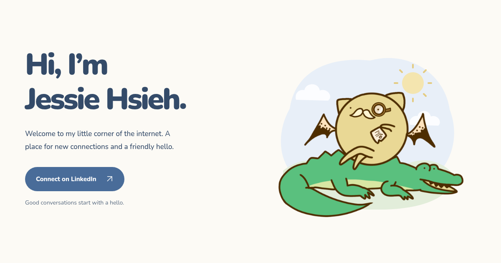

# Jessie Hsieh · OuO

A friendly personal homepage with LinkedIn as its primary action, plus GitHub and Blog links. Rounded typography and a soft palette frame the owner’s cat-on-a-crocodile illustration from [Jessie’s blog](https://blog.jessie-ouo.link/). Uses [Taste Skill](https://www.tasteskill.dev/) guidance and the owner’s visual direction.



React produces complete HTML at build time. A **1.3 KB inline theme script** adds the day/night toggle; no React runtime or hydration is shipped. Fonts are local and the minified stylesheet is content-hashed. Cloudflare Workers serves the files directly through Workers Static Assets; no Worker runtime or database is needed.

The header’s moon/sun button switches the page and illustration together: a sun with rays in light mode, a crescent and stars in dark mode. A first visit follows the system setting; a manual choice is saved in local storage and synchronized across tabs. If storage is unavailable, switching still works for the current visit. With JavaScript disabled, the page and scenery follow the system and the inactive toggle is hidden.

## Develop with Bun

Install [Bun](https://bun.sh/) 1.4.3 or newer, then:

```sh
bun install --frozen-lockfile
bun run dev
```

Open `http://127.0.0.1:3000`. Development and `--preview` builds deliberately use `noindex` and do not emit a canonical URL or sitemap. Bun watches the imported TypeScript source. Restart the dev command after CSS or public asset changes.

## Production and Cloudflare Workers

Set the real public HTTPS origin before building. The build refuses missing, insecure, credential-bearing or non-root URLs instead of shipping a placeholder canonical.

```sh
cp .env.example .env
# Edit SITE_URL in .env to your actual domain.
bun run build
bun run preview
```

Choose either deployment method:

- **Workers Builds connected to GitHub:** import this repository; set build command to `bun install --frozen-lockfile && bun run verify && bun run build`, deploy command to `bun --bun wrangler deploy`, and build variable `SITE_URL` to your public origin. Set build variable `BUN_VERSION=1.4.3` if your build image needs an explicit version. Add your domain under the Worker’s **Settings → Domains & Routes → Add → Custom Domain**.
- **Bun CLI:** provide your own Cloudflare account authentication using `CLOUDFLARE_API_TOKEN` and `CLOUDFLARE_ACCOUNT_ID`, then run `bun run deploy:check` and `bun run deploy`. Add the custom domain in the Cloudflare dashboard.

No Cloudflare credentials are committed. `wrangler.jsonc` declares a static-only Worker, and unknown paths use a genuine HTTP 404 page. The build adds the exact theme script’s SHA-256 hash to the generated `_headers` CSP, allowing that script without `unsafe-inline`. The script runs before the stylesheet to apply saved preferences before first paint. Security headers and immutable asset caching remain enabled. The primary link uses normal same-tab navigation.

## Quality and performance

```sh
bun run verify          # Biome check, TypeScript 7 strict, Vitest, preview build
bun run format         # Biome formatter
bun run lint           # Biome with the React domain explicitly enabled
bun run deps:check     # npm-check-updates: latest stable releases
bun run deps:update    # update manifest and Bun lockfile; re-run verify afterward
```

Browser checks and Lighthouse need an existing Chromium or Chrome. Set `CHROME_PATH` if it is not `/usr/bin/chromium`. These commands run on Bun; a Node installation is not required.

```sh
bun run build          # requires SITE_URL; audit an indexable production build
bun run test:browser   # responsive/theme checks, WCAG AA, keyboard, persistence, storage fallback, JS disabled, 404
bun run perf           # three Lighthouse mobile runs and saved HTML/JSON reports
bun run social         # regenerate the tracked 1200×630 social image after design edits
```

`perf` requires a median mobile performance score of at least 95 and accessibility, best practices and SEO scores of 100. Reports and screenshots live in `reports/`. The build enforces uncompressed budgets of 12 KB HTML (including the inline script), 12 KB CSS, 80 KB total fonts and 4 KB for the theme script itself. Lighthouse is a local lab measurement; audit the final public domain after deployment to measure CDN delivery, redirects and TLS. Google indexing and real-world Core Web Vitals depend on the deployed site and traffic.

GitHub Actions installs Bun, runs the same checks, audits a **test-only** production origin, and uploads browser/Lighthouse reports. The CI build is never deployed automatically.

## Organization and design

```text
src/config/       Zod-validated identity and deployment origin
src/components/   semantic, reusable React components
src/client/       small TypeScript theme enhancement
src/pages/        homepage and 404
src/seo/          Person JSON-LD, robots and sitemap
src/styles/       tokens, responsive layout and manual/system themes
scripts/          Bun build, local server, browser QA and Lighthouse
public/           favicon, social card, Cloudflare headers
tests/            production configuration and rendered SEO contracts
```

All application, build, tooling and test code is strict TypeScript 7, targeting ESNext. `node:` imports are Bun’s built-in compatibility APIs; the project never launches the Node runtime. Vitest calls its server test environment `node`, but runs here through `bun --bun vitest`.

The single Nunito variable font is self-hosted, Latin-only and licensed under the SIL Open Font License. Its license text is in `licenses/`. The blog illustration is self-hosted as responsive, content-hashed WebP images; the sky, clouds and meadow render as a small decorative SVG. Image provenance is recorded in [ASSETS.md](ASSETS.md). There are no external font/image requests, analytics, cookies or third-party embeds. React and Zod are build-time dependencies, not browser payloads.

shadcn was considered; native links and one theme button keep this page small and accessible. Firebase/Firestore are unnecessary for this static homepage and have not been added. No job title, biography, employer, location or availability is invented. Update identity in `src/config/site.ts` and copy in `src/components/identity-card.tsx` when you want to expand the page.

See [DESIGN.md](DESIGN.md) for Taste Skill decisions and explicitly documented exceptions to its image and animation quotas.
